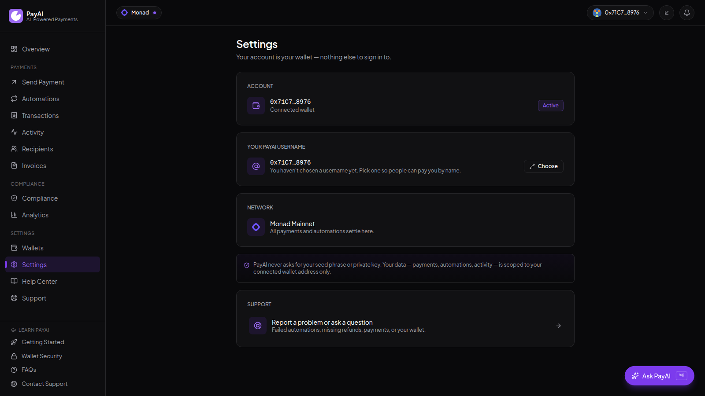

<div align="center">


# PayAI

**Turn Natural Language intent into on chain execution.**

[Live app](https://usepayai.xyz) · [Report an issue](https://github.com/tweetbysobur/PayAI/issues)

</div>

---

PayAI is a non-custodial payment platform on Monad Mainnet. Describe a payment in plain
English — "send 10 USDC to a .nad domain," "swap 100 MON to USDC," "pay contributors every
Friday" — and PayAI parses it, checks it, and prepares it for your own wallet to sign.
Nothing moves until you approve it.

It's also a full dashboard: send, swap, automate, distribute to many recipients at once,
and see everything that happened, with a real transaction hash at the end of every settled
payment.

## The problem

Paying someone on-chain today means holding several things in your head at once: a wallet
you had to set up first (seed phrase written down somewhere, or an extension installed), the
exact recipient address copy-pasted correctly, the right token and network, and — if it's a
payment that repeats — remembering to come back and sign it again next week, on time, every
time. Miss the date and it doesn't send itself. Need to pay fifty people instead of one, and
it's fifty manual transactions instead of one workflow. None of that is a smart-contract
problem; it's friction that sits entirely on the human doing the paying.

## The solution

PayAI collapses that into one non-custodial platform. A wallet is a passkey away — no seed
phrase to write down, no extension to install — and from there, sending, swapping,
automating, and paying many recipients at once all live in the same place, described in
plain English if you'd rather not fill out a form. Every payment is still signed by your own
wallet; PayAI prepares the transaction and gets out of the way. An automation that has to
run without you is capped on-chain to exactly what you authorized, never more, and a
scheduled payment backed by Reserved Funds can't fail for insufficient balance because the
budget was already set aside — refunded back to you if you cancel before it's used.

## Mission & vision

Make paying someone on Monad take no more expertise than sending a message. That's the
whole bet: wallet setup, recipient resolution, screening, and repetition are all solvable
in software, and none of them should be the reason someone doesn't use on-chain payments.
The near-term roadmap (see [Status](#status)) is about extending that same one-click,
plain-English standard from personal payments to payroll, treasury, and bulk distributions
— the same guarantees, at whatever scale the payment actually needs.

## Use cases

- **Personal payments** — rent, an allowance, a recurring gift, moving money into savings —
  set the schedule once, approve once, done
- **One-off transfers** — send MON or USDC to an address or a `.nad` domain in one message,
  no address book required
- **Swapping between assets** — hold MON but owe someone in USDC (or the other way around)?
  Swap first, pay second, without leaving PayAI
- **Paying many people at once** — a reward pool, a small team, a list of addresses from a
  CSV — validate every recipient and see the full allocation before a single signature
- **Businesses and DAOs standing up payroll, vendor payments, or treasury distributions** —
  the underlying engine (Wallet Automation, Reserved Funds, bulk distribution) already
  supports this; the guided templates for it are still being finished, and the app marks
  each one's real status rather than pretending otherwise (see [Status](#status))

## What it does today

- **Parses plain-English payment instructions** into structured transactions — the AI
  layer is optional; without an API key it falls back to a deterministic parser (regex +
  rules), so the app runs, and stays free, with no model calls at all
- **Sends MON (native) and USDC (ERC-20)**, and resolves `.nad` / `.nads` names through
  the Nad Name Service instead of raw addresses
- **Swaps MON ↔ USDC** on-chain through Uniswap v3, quoted live and signed by your own
  wallet
- **Embedded wallet** — a self-custody Monad wallet from a passkey, powered by
  [Mera](https://github.com/category-labs/mera). No seed phrase, no browser extension, and
  no key material ever reaches PayAI's servers; export the raw private key at any time from
  Wallet Settings if you want to leave
- **External wallets** work the same way, connected over EIP-6963/EIP-1193 — and an
  embedded and an external wallet can be linked to one account, with a chosen default for
  payments and a separate one for automations
- **Payment Automations** for recurring and future-dated payments, in either of two
  funding modes: **Wallet Automation** (a capped allowance the agent pulls from on each
  run) or **Reserved Funds** (the budget is pre-deposited into an on-chain vault up front,
  so a run can't fail for insufficient balance — and cancelling refunds whatever's unspent)
- **Bulk distributions** — CSV/Excel import or manual entry, split equally, by fixed
  amount, by percentage, or custom, with every address validated before you sign
- **Screens every payment** — sanctions/denylist check, asset + network support, a
  travel-rule nudge on large transfers, and a risk score
- **Records every settlement on-chain** — agent, recipient, amount, risk score, validation
  result, and an idempotency key so a retry can never double-pay
- **A merged activity feed and notifications** across payments, swaps, automations, and
  wallet events, plus transaction history with explorer links and volume/trend analytics

## How it works

A message goes through a short pipeline before anything touches the chain:

```
"send 10 USDC to a .nad domain"
        │
        ▼
  Intent parsing        what action, how much, which token, who to
        │
        ▼
  Validation            is the recipient real, is the asset/network supported,
        │               does a large transfer state a purpose
        ▼
  Risk scoring          0–100 from amount, recipient type, missing context
        │
        ▼
  Your wallet signs     non-custodial — a passkey confirmation for an embedded
        │               wallet, a signature prompt for an external one
        ▼
  PaymentExecutor       settles + writes an on-chain record in one transaction
        │
        ▼
  Monad Mainnet         real settlement, then a link to the explorer
```

Every stage is a TypeScript module in this repo. Intent parsing can optionally
call Anthropic; persistence uses Upstash Redis when configured; the embedded
wallet is derived client-side by Mera. Validation, risk, execution, and
settlement live in `lib/` — they are not a third-party "trust layer."

## Screenshots

| Landing | Dashboard | Send a payment | Settings |
| --- | --- | --- | --- |
|  |  |  |  |

## Non-custodial, and where it isn't

Interactive payments are non-custodial, for either wallet kind. An embedded wallet is
derived from your device's passkey via WebAuthn's PRF extension — the key exists only in
your browser, PayAI never sees it, and you can export it at any time. An external wallet
signs the same way it always has, in its own extension or app.

The two exceptions: Payment Automations, which can't wait for you to click
"approve" at 9am every Friday, and the optional Telegram trading bot.

Wallet Automation runs through an agent contract that can only spend within
per-transaction and daily caps you set on-chain — it can't exceed them and can't
touch anything you didn't automate. Reserved Funds goes further: the budget is deposited
into an isolated on-chain vault per automation up front, and the agent can only ever
release it to the recipient you committed to, or refund it back to you.

The Telegram bot is custodial. It generates a hot wallet per Telegram user and
stores the key encrypted at rest so trades can sign from chat. `/start` discloses
this every time. Don't send that address more than you're willing to trust to a bot.

## Stack

Next.js 16 (App Router) and React 19 on the front, TypeScript throughout. Tailwind 4 for
styling, `motion` for the bits that move. Charts are hand-built SVG, not a charting
library — no dependency for a dozen bars.

On-chain work is `viem` against Monad Mainnet (chain ID 143). Smart contracts are Solidity
built with Hardhat (`contracts/`). Domain resolution uses the official Nad Name Service
viem SDK. The embedded wallet is [Mera](https://github.com/category-labs/mera) — passkey
key derivation, entirely client-side, no backend involved. Persistence (tx log, analytics,
idempotency, wallet events) is Upstash Redis when configured, with an in-memory fallback
for local dev. The optional AI parsing layer is the Anthropic SDK.

## Running it locally

```bash
npm install
cp .env.example .env.local
npm run dev            # http://localhost:3100
```

Out of the box it runs in **simulation** mode: the full pipeline executes, but settlement
is faked so no funds move and you don't need a wallet key or an API key. Good enough to
click around the whole app offline.

To settle for real, set these in `.env.local`:

```bash
PAYAI_MODE=monad                       # real on-chain instead of simulation
MONAD_NETWORK=mainnet
MONAD_MAINNET_RPC=https://rpc.monad.xyz
MONAD_AGENT_PRIVATE_KEY=0x...          # server-side signer for the automation/agent path
MONAD_MAINNET_USDC=0x...               # canonical USDC on Monad Mainnet
MONAD_MAINNET_PAYMENT_EXECUTOR=0x...   # deployed executor
MONAD_MAINNET_MERCHANT_REGISTRY=0x...
VERIPAYAI_API_KEY=...                  # required once a live signer is configured — gates write routes
```

The embedded wallet needs nothing here — no API key, no project id. It derives entirely
from the user's passkey in the browser. Sign-in over Google/Apple/X/Email is optional and
independently configured (`AUTH_SESSION_SECRET` plus each provider's own credentials); an
unconfigured method is simply not offered rather than shown broken.

Optional knobs:

```bash
ANTHROPIC_API_KEY=...                  # enables Claude parsing; omit for the free rule-based parser
PAYAI_TRAVEL_RULE_THRESHOLD=10000000   # amount above which a transfer should state a purpose (soft note only, never blocks)
PAYAI_DENYLIST=sanctioned,blocked,ofac # name-substring screen
PAYAI_ADDRESS_DENYLIST=0x...           # exact address screen
```

Full list with comments — including Reserved Funds, wallet linking, and every sign-in
provider — is in `.env.example`.

## Smart contracts

Four contracts under `contracts/`:

- **PaymentExecutor** — settles a payment and writes the audit record (recipient, amount,
  risk score, validation result, idempotency key) in a single transaction. Enforces
  replay protection and per-agent daily caps on-chain.
- **AutomationVault** — Reserved Funds' execution model. Holds a user's pre-deposited
  budget for one specific automation, isolated from every other reservation, and can only
  release it to the committed recipient or refund it to the original depositor — never
  anywhere else.
- **MerchantRegistry** — the payee directory the executor checks against, tracking
  per-merchant volume.
- **VeriPayRegistry** — an on-chain audit trail binding each settled payment's validation
  decision and risk score to an immutable record.

```bash
cd contracts
npm install
npx hardhat test                                    # unit tests
npx hardhat run scripts/deploy-suite.js --network monad
```

The live mainnet addresses are wired through the env vars above; the running app links
straight to the executor on the Monad explorer from its footer.

## Layout

```
app/
  api/            route handlers — agent pipeline, automations, swap, wallet events,
                  linked wallets, wallet intelligence, health, onchain…
  dashboard/      the authenticated app — payments, automations, transactions, activity,
                  wallets, analytics, compliance, recipients, invoices, settings, support
  auth/           sign-in — embedded wallet, or Google/Apple/X/Email when configured
  connect/        connect an external wallet
  product/        capability depth (moved off the landing page to keep the pitch short)
  how-it-works/   the mechanics — six-step walkthrough, security, the AI operator
  page.tsx        landing page
lib/
  agent/          intent parsing, guardrails, confidence
  payment/        validation + risk engines, execution providers, payment types
  monad/          chain config, wallet, executor, swap, domain resolution
  automation/     templates, bulk distribution, scheduling
  wallet/         EIP-1193/EIP-6963 external wallet connection
  wallet-service/ provider-agnostic wallet contract — the ONE thing the rest of the app
                  depends on for wallet access (embedded via Mera, or external)
  auth/           session cookie, OAuth, email sign-in
  platform/       tenancy, store, analytics, idempotency, wallet events, linked wallets
  hooks/          React hooks
contracts/        Hardhat + Solidity
```

## Status

v0.1.0 — live and settling real payments on Monad Mainnet. It's a working product, not a
finished one. The honest open edges: the denylist is a substring screen plus OFAC SDN
addresses rather than a licensed KYC/AML programme, Apple sign-in isn't wired yet, most
automation templates beyond the personal ones are still being finished, the application
source is private (contracts are verified on the explorer), and the Telegram bot is a
custodial exception to the non-custodial web app. Those are marked in the product where
they matter.

## License

MIT.
