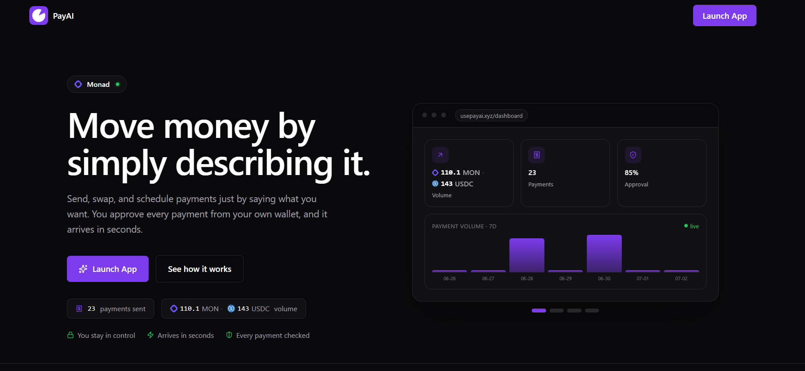
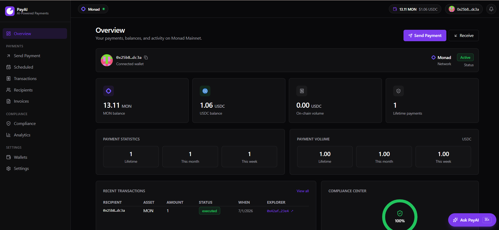
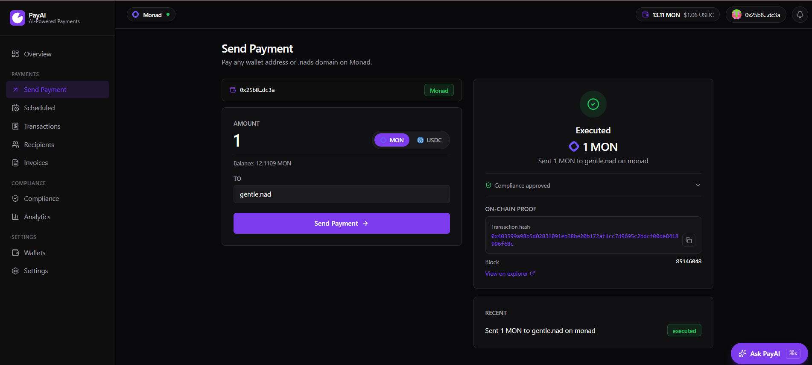

<div align="center">


# PayAI

**Pay on Monad by typing what you want.**

[Live app](https://usepayai.xyz) · [Report an issue](https://github.com/tweetbysobur/PayAI/issues)

</div>

---

Pay someone on Monad by typing what you want. "Send 10 USDC to alex.nads" gets parsed,
checked, and settled on-chain — you sign it in your own wallet, and there's a real
transaction hash at the end you can look up on the explorer.

That's the whole idea. No dashboards full of forms, no copy-pasting addresses, no
custody. You talk, PayAI figures out the transaction, your wallet approves it.

## How it works

A message goes through a short pipeline before anything touches the chain:

```
"send 10 USDC to alex.nads"
        │
        ▼
  Intent parsing        what action, how much, which token, who to
        │
        ▼
  Validation            is the recipient real, is the asset/network supported,
        │               does a large transfer state a purpose
        ▼
  Risk scoring          0–100 from amount, recipient type, missing context
        │
        ▼
  Your wallet signs     non-custodial — the key never leaves your browser
        │
        ▼
  PaymentExecutor       settles + writes an on-chain record in one transaction
        │
        ▼
  Monad Mainnet         real settlement, then a link to the explorer
```

Every stage is a plain TypeScript module in this repo. Nothing is farmed out to a
third-party service, and there's no external "trust layer" in the loop — validation,
risk, execution, and settlement all live in `lib/`.

## Screenshots

| Landing | Dashboard | Send a payment |
| --- | --- | --- |
|  |  |  |

## What it does today

- Parses plain-English payment instructions into structured transactions
- Sends MON (native) and USDC (ERC-20)
- Resolves `.nad` / `.nads` names through the Nad Name Service instead of raw addresses
- Swaps MON ↔ USDC on-chain
- Schedules recurring and future-dated payments (these run through a spend-capped agent
  contract, since you're not around to sign each one — the caps are set on-chain)
- Screens every payment: sanctions/denylist check, asset + network support, a
  travel-rule nudge on large transfers, and a risk score
- Records each settled payment on-chain — agent, recipient, amount, risk score,
  validation result, and an idempotency key so a retry can't double-pay
- Keeps a full transaction history with explorer links, plus volume/trend analytics

The AI parsing layer is optional. Without an `ANTHROPIC_API_KEY` it falls back to a
deterministic parser (regex + rules), so the app runs — and stays free — with no model
calls at all. With a key, Claude handles the messier phrasings.

## Non-custodial, and where it isn't

Interactive payments are non-custodial. You connect your wallet, PayAI builds the
transaction, you approve it. PayAI never sees your seed phrase and never holds a key for
your funds.

The one exception is scheduled/recurring payments. Those can't wait for you to click
"approve" at 9am every Friday, so they go through an agent contract that can only spend
within per-transaction and daily caps you set on-chain. It can't exceed those limits, and
it can't touch anything you didn't schedule.

## Stack

Next.js 16 (App Router) and React 19 on the front, TypeScript throughout. Tailwind 4 for
styling, `motion` for the bits that move, `recharts` for the analytics.

On-chain work is `viem` against Monad Mainnet (chain ID 143). Smart contracts are Solidity
built with Hardhat. Domain resolution uses the official Nad Name Service viem SDK.
Persistence (tx log, analytics, idempotency) is Upstash Redis when configured, with an
in-memory fallback for local dev. The optional AI layer is the Anthropic SDK.

## Running it locally

```bash
npm install
cp .env.example .env.local
npm run dev            # http://localhost:3100
```

Out of the box it runs in **simulation** mode: the full pipeline executes, but settlement
is faked so no funds move and you don't need a wallet key or an API key. Good enough to
click around the whole app offline.

To settle for real, set these in `.env.local`:

```bash
PAYAI_MODE=monad                       # real on-chain instead of simulation
MONAD_NETWORK=mainnet
MONAD_MAINNET_RPC=https://rpc.monad.xyz
MONAD_AGENT_PRIVATE_KEY=0x...          # server-side signer for the scheduled/agent path
MONAD_MAINNET_USDC=0x...               # canonical USDC on Monad Mainnet
MONAD_MAINNET_PAYMENT_EXECUTOR=0x...   # deployed executor
MONAD_MAINNET_MERCHANT_REGISTRY=0x...
VERIPAYAI_API_KEY=...                  # required once a live signer is configured — gates write routes
```

Optional knobs:

```bash
ANTHROPIC_API_KEY=...                  # enables Claude parsing; omit for the free rule-based parser
PAYAI_TRAVEL_RULE_THRESHOLD=250        # amount above which a transfer should state a purpose
PAYAI_DENYLIST=sanctioned,blocked,ofac # name-substring screen
PAYAI_ADDRESS_DENYLIST=0x...           # exact address screen
```

Full list with comments is in `.env.example`.

## Smart contracts

Two contracts under `contracts/`:

- **PaymentExecutor** — settles a payment and writes the audit record (recipient, amount,
  risk score, validation result, idempotency key) in a single transaction. Enforces
  replay protection and per-agent daily caps on-chain.
- **MerchantRegistry** — the payee directory the executor checks against, tracking
  per-merchant volume.

```bash
cd contracts
npm install
npx hardhat test                                    # unit tests
npx hardhat run scripts/deploy-suite.js --network monad
```

The live mainnet addresses are wired through the env vars above; the running app links
straight to the executor on the Monad explorer from its footer.

## Layout

```
app/
  api/            route handlers — agent pipeline, health, onchain, swap, schedule…
  dashboard/      the authenticated app (payments, transactions, analytics, compliance)
  page.tsx        landing page
lib/
  agent/          intent parsing, guardrails, confidence
  payment/        validation + risk engines, execution providers, payment types
  monad/          chain config, wallet, executor, swap, domain resolution
  platform/       auth, tenancy, store, analytics, idempotency, schedules
  hooks/          React hooks
  wallet/         EIP-1193 browser wallet connection
contracts/        Hardhat + Solidity
```

## Status

v0.1.0 — live and settling real payments on Monad Mainnet. It's a working product, not a
finished one. The honest open edges: the denylist is a substring screen rather than a real
screening provider, and the model layer stays off unless you bring a key. Both are marked
in the code where they matter.

## License

MIT.
