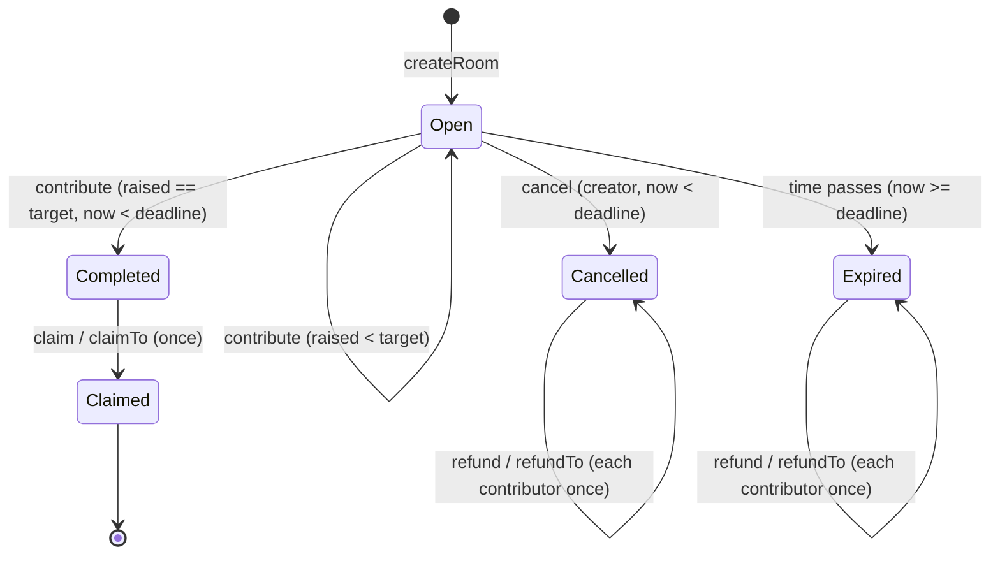
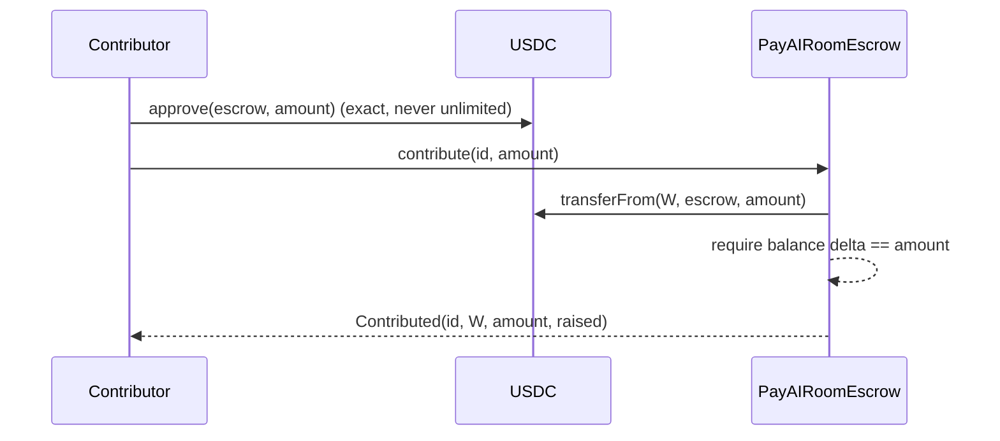

# PayAIRoomEscrow — pre-audit package

> **Archived.** Rooms were removed from PayAI in October 2026. This document
> describes the removed feature and is kept as a record only.

Prepared 2026-10-10 for an **independent** smart-contract security audit.
Updated the same day for the PA-01 / PA-04 / PA-11 decisions, and then for the
approved PA-05 minimum contribution policy (§K).

> **Status: UNAUDITED and UNDEPLOYED.** Everything below is PayAI's own
> preparation: an internal review, tests and coverage that PayAI wrote and
> ran. None of it is an independent audit and none of it should be read as
> one. The contract has never been deployed to Monad testnet or mainnet, and
> escrow Rooms are disabled in production.

Companion documents: `ESCROW_AUDIT.md` (original gap analysis),
`ESCROW_ROOMS.md` (product semantics) and `ESCROW_SECURITY_REVIEW.md` (first
internal review and its fixes, D1–D6).

---

## 0. Scope and snapshot

**In scope for the audit:**

| File | SHA-256 (working tree, 2026-10-10) |
|---|---|
| `contracts/contracts/PayAIRoomEscrow.sol` | `0ead96b15e497942f92d0c3dc069aa96b7e421698a8396d8c23f2db4afe302c6` |
| `contracts/scripts/deploy-room-escrow.js` (deployment procedure) | `6d084f148a0e99d0cb9269490bf3c82408e7208e6a82793add80c22bf39d6040` |

**Supporting files (not production code):**

| File | SHA-256 |
|---|---|
| `contracts/contracts/mocks/RoomEscrowMocks.sol` | `d826c21bb90944008fe78c9b353bc6c31264b7bcddd747d9f2c157ac77202cac` |
| `contracts/test/PayAIRoomEscrow.test.js` | `5c87dc5947e206437d923e6dac79f74418a1c3f216af28c6bfb1f5814d4b5065` |
| `contracts/test/PayAIRoomEscrow.adversarial.test.js` | `e4c49bea7029e5be7a18c624d10adae057ade81b040fa233b7024f97d57b8d71` |
| `contracts/test/PayAIRoomEscrow.decisions.test.js` | `4e80f10443dec1473104dc325209e98ee355c0b259d832dbca0d10fcca680deb` |
| `contracts/test/PayAIRoomEscrow.invariants.test.js` | `8470e780c77c8177b10056be10ee63a1fce0a6a2d4a6ccfa16c6cd064b728b5f` |
| `contracts/hardhat.config.js` | `83484a0e9656aba62ae5b806ec2a0dd799277ff4bdfaf8fc4e5c13d9f7098e91` |
| `contracts/package-lock.json` | `de4aae160defc3f3d674ebb3882a8dea43dd944d7b8405ca085c539b86ddfcbc` |

These files are **uncommitted** on branch `claude/bitv-s3ctfc` (HEAD
`1afbd29`). Before engaging an auditor, commit them and give the auditor the
commit hash. The audit must cover exactly that commit, and the hashes above
must match it.

The app-side integration is out of scope for the Solidity audit, but listed
in §2 so the auditor can see which rules the contract alone enforces. It
lives in `lib/sdk/actions/room-escrow/index.ts`, `lib/rooms/escrow*.ts`,
`lib/plan/review.ts`, `app/api/rooms/**`, `components/rooms/escrow/**` and
`components/ask/EscrowRoomAskCard.tsx`.

**Toolchain:**
- Compiler: solc `0.8.24+commit.e11b9ed9`, optimizer on with 200 runs, EVM target `paris`.
- Single file, no imports, no external libraries (no OpenZeppelin).
- Hardhat 2.28.6, hardhat-toolbox 5.0.0, ethers 6.17.0, chai 4.5.0, solidity-coverage 0.8.17, hardhat-gas-reporter 1.0.10, Node 22.22.2.
- Runtime bytecode is 13,059 bytes (the EIP-170 limit is 24,576). Deployment gas is about 2.96M.

---

## A. System overview

**What PayAI Rooms does.** A creator opens a Room with fixed terms and shares
a link. Anyone contributes MON or the configured USDC. The contract holds
contributions until either:
- **success**: the Room reaches its target before its deadline. Anyone can
  then trigger the claim, which always pays the fixed beneficiary the
  proceeds minus a 0.5% platform fee; or
- **failure**: the deadline passes first, or the creator cancels. Every
  contributor can then take back exactly what they put in.

**Room models** (`Kind`):

| Kind | Terms | Contribution rule | Completion |
|---|---|---|---|
| `FixedShare` | `share` (≥ the token's platform minimum), `slots` (2–1000), `target = share × slots` | exactly `share`, once per address | `raised == target` (all slots paid) |
| `Target` | `target` and `minContribution`, both ≥ the token's platform minimum | `amount ≤ remaining` and (`amount ≥ min` or `amount == remaining`); repeat contributions allowed | `raised == target` |

- **Platform minimum contribution (PA-05).** The owner sets a per-token floor,
  `minContributionFloor[token]`, which must be greater than zero. Native MON's
  floor is set in the constructor. Approved values: **1 MON (10^18 wei)** and
  **0.5 USDC (500,000 base units, 6 decimals)**. `createRoom` refuses:
  - a token with no floor (fail closed);
  - a fixed `share` below the floor;
  - a target room whose `minContribution` or `target` is below the floor.

  The floor is thus baked into each room's own immutable `share` or
  `minContribution`. `contribute` is unchanged, so the exact remainder is
  always accepted and every valid room can complete. A floor change affects
  only rooms created afterwards.

- **Funds in.** `contribute(roomId, amount)`. For MON, `msg.value` must equal
  `amount`. For ERC-20, `transferFrom(msg.sender → escrow, amount)` with a
  balance-delta check, so short delivery reverts.
- **Completion** is recorded in `completedAt` by the contribution that makes
  `raised == target`. That contribution can only land while
  `block.timestamp < deadline`.
- **Claim.** `claim(roomId)` can be called by **anyone** (PA-11) and always
  pays the beneficiary fixed at creation; the caller receives nothing.
  `claimTo(roomId, to)` can be called only by the beneficiary. Together they
  work once per room, after completion.
- **Refund.** `refund(roomId)` or `refundTo(roomId, to)`, by the contributor,
  once each. It is allowed if the room was cancelled, or the deadline passed
  without completion.
- **Fee.**
  - At creation the room snapshots `feeBps` (≤ `MAX_FEE_BPS = 50`) and `treasury`.
  - On claim: `fee = floor(raised × feeBps / 10000)` is added to
    `feesOwed[treasury][token]`, and `raised − fee` is sent to the recipient.
  - `withdrawFees(treasury, token)` (anyone may call) sends the accrued
    amount to that treasury only.
  - `recoverFees(fromTreasury, token)` (owner only, PA-01) moves an old
    treasury's accrued balance onto the **current** treasury's balance. It is
    accounting only and transfers no tokens.
  - Refunds never carry a fee.

## B. Trust boundaries

| Actor | Can do on-chain | Cannot do |
|---|---|---|
| **Owner** (intended: the PayAI Safe `0xA282833B52b1B66D58bD2007081dCC037798C0b0`, as used by other live PayAI contracts; **needs confirmation for this deployment**) | `setPaused` (blocks only `createRoom` and `contribute`); `setFeeBps` (≤ 50, future rooms); `setTreasury` (future rooms); `setTokenSupported` (future rooms); `setMinContributionFloor` (> 0, future rooms only); `recoverFees` (moves accrued **fees** from a non-current treasury to the current one; accounting only, PA-01); `transferOwnership` / `acceptOwnership` (two-step) | Move, redirect or freeze room principal, payouts or refunds; choose a fee destination other than the current treasury; change any existing room's terms (including its snapshotted treasury); cancel rooms; block claims, refunds or fee withdrawals |
| **Creator** | Create rooms; `cancel` its own open room before the deadline and before completion (PA-04) | Choose where a claim pays; cancel a completed room; touch contributions |
| **Beneficiary** | `claim` / `claimTo` its completed room (`claimTo` can send the net anywhere except the zero address or the escrow) | Claim before completion or twice; cancel |
| **Contributor** | `contribute`; `refund` / `refundTo` its own contribution when eligible | Refund someone else's contribution, refund a completed room, or refund twice |
| **Treasury** | Receives `withdrawFees` payouts | Redirect its own accrued fees (only the owner's `recoverFees` can, and only onto the current treasury) |
| **Token contracts** | Trusted to behave as standard ERC-20 (bool returns, exact transfers). The issuer can pause or blocklist (USDC). | — (see PA-02, PA-09) |
| **Anyone** | `claim` a completed room (pays only its fixed beneficiary; the caller gets nothing, PA-11); `withdrawFees` (pays only the named treasury); view functions | `claimTo`; choose any payee; claim twice or before completion; anything else |

**Enforced only by the application, NOT by the contract:**
- **Minimum values and USDC decimals:** the contract enforces whatever floor
  the owner sets. The app refuses to create rooms unless the escrow's floor
  equals PayAI's policy (1 MON; 0.5 USDC). For USDC it first checks the live
  token's `decimals() == 6`. An omitted target-room minimum defaults to the
  platform minimum.
- **Token set:** only MON and the configured USDC (`MONAD_MAINNET_USDC`). The
  contract accepts any owner-allowlisted ERC-20.
- **Fee:** the app refuses to create rooms unless the escrow's live
  `feeBps == 50`. The contract allows 0–50.
- **Duration:** the app uses 1–90 days and adds a 15-minute signing margin.
  The contract allows 1 hour to 90 days.
- **Off-chain metadata:** title, description and public listing are stored
  in KV. Only their hash (`termsHash`) is on-chain; the contract doesn't
  interpret it.
- **Screening and moderation:** the app runs PayAI's sanctions and risk
  policy on the beneficiary as the "recipient" of each contribution plan.
  The Live Rooms directory and its opt-in flag exist only in the app. There
  is no moderation.
- **Adoption and display:** the app adopts an on-chain room only if its
  `RoomCreated` event matches the previewed terms exactly. Contributors are
  displayed as numbers, not addresses, and activity counts only
  app-verified transactions.
- **Transaction building:** the plan pipeline approves the exact
  `amount`, never unlimited, and the escrow address is the only allowed
  target (both enforced by Layer B).

**Off-chain components and external services:**
- **Mera embedded wallet:** a passkey (WebAuthn PRF) derives a secp256k1 key
  held in browser memory only. PayAI's server never sees keys.
- **External wallets:** via EIP-1193 or WalletConnect.
- **Monad RPC:** read and confirmation. **Upstash/Redis KV:** room metadata,
  plan records and verified-event logs. **Vercel:** hosting and environment.
- **`.nad` name resolver:** used when the beneficiary is given as a name.
- None of these can move escrowed funds. If PayAI's servers are down, every
  claim and refund can still be called directly on the contract.

## C. Contract architecture

**Storage:**
- `owner`, `pendingOwner`, `paused`, `treasury`, `feeBps`, `roomCount`;
- `tokenSupported[token]`;
- `minContributionFloor[token]` (PA-05; `address(0)` = MON);
- `_rooms[id]` (the `Room` struct below);
- `contributionOf[id][addr]`;
- `feesOwed[treasury][token]`;
- `_locked` (the reentrancy guard).

**Room struct.** Terms are written once and never again: `creator`,
`beneficiary`, `token`, `treasury`, `kind`, `feeBps`, `deadline`, `slots`,
`share`, `target`, `minContribution`, `termsHash`. Progress fields: `raised`
(monotonic), `refunded`, `contributors`, `completedAt`, `claimed`,
`cancelled`.

**State machine** (derived by `statusOf`, never stored):



**External calls.** All of them are in `contribute` (`transferFrom` and
`balanceOf`) and in `_send` (MON `.call` or ERC-20 `transfer` + `balanceOf`):
- `contribute` updates state before its ERC-20 pull. It checks `msg.value`
  after the effects, which is safe because a mismatch reverts the whole call.
- `_claim` sets `claimed` and accrues the fee before sending.
- `_refund` zeroes `contributionOf` before sending.
- `withdrawFees` zeroes `feesOwed` before sending.
- One `nonReentrant` lock covers every mutating entry point, so re-entry into
  any of them is blocked (tested for the eight user-facing entry points;
  `recoverFees` makes no external call).

**Events:**
- **Rooms:** `RoomCreated` (every term); `Contributed` (amount and running
  `raised`); `RoomCompleted`; `Claimed` (`to`, `net`, `fee`, `treasury`);
  `RoomCancelled`.
- **Refunds:** `Refunded` (contributor and amount), plus `RefundSent` (with
  `to`) for `refundTo`.
- **Fees:** `FeesWithdrawn`, `FeesRecovered` (from, to, token, amount).
- **Admin:** `PausedSet`, `FeeBpsSet`, `TreasurySet`, `TokenSupportSet`, `MinContributionFloorSet`,
  `OwnershipTransferStarted`, `OwnershipTransferred`.

**Privileged functions:** `setPaused`, `setFeeBps`, `setTreasury`,
`setTokenSupported`, `setMinContributionFloor`, `recoverFees`, `transferOwnership`. (`acceptOwnership` is callable by
`pendingOwner` only.) There is no upgradeability, proxy, delegatecall,
self-destruct, arbitrary call or sweep function, and no initializer.

**Limits:**
- `MAX_FEE_BPS = 50`
- `minContributionFloor[token] > 0` is required to create a room in that token
- `MAX_TARGET = uint256.max / 10000`, so `raised × feeBps` can't overflow
- `MIN_SLOTS = 2`, `MAX_SLOTS = 1000`
- `MIN_DURATION = 1 hour`, `MAX_DURATION = 90 days`

## D. Fund flows

**1. Room creation (no funds move):**
```mermaid
sequenceDiagram
  participant C as Creator wallet
  participant App as PayAI app (plan + review)
  participant E as PayAIRoomEscrow
  C->>App: preview terms (fee 0.5%, net, conditions)
  App->>E: read feeBps/treasury/tokenSupported/paused (views)
  C->>E: createRoom(kind, token, beneficiary, share, slots, target, min, deadline, termsHash)
  E-->>E: snapshot feeBps + treasury; store terms
  E-->>App: RoomCreated(all terms)
  App-->>App: adopt only if every term == preview
```

**2. MON contribution:** contributor → `contribute(id, amount)` with
`msg.value = amount`. The escrow balance rises by `amount`, and
`contributionOf`, `raised` and `contributors` update.

**3. USDC contribution** (two transactions, both signed by the contributor):


**4–5. Successful fixed-share and target rooms:** contributions accumulate
until the contribution that makes `raised == target` sets `completedAt` and
emits `RoomCompleted`. Every later contribution reverts.

**6. Expired, unsuccessful room:** at `now ≥ deadline` with
`completedAt == 0`, `statusOf` returns `Expired`. Claims revert
(`not complete`), and each contributor calls `refund` or `refundTo`.

**7. Creator cancellation:** `cancel(id)` while open and before the deadline
sets `cancelled`. Contributions are refundable immediately, and claims revert.

**8. Successful claim:**
```mermaid
sequenceDiagram
  participant B as Anyone (claim) / Beneficiary (claimTo)
  participant E as PayAIRoomEscrow
  participant R as Recipient (beneficiary, or claimTo target)
  B->>E: claim(id) / claimTo(id, to)
  E-->>E: claimed = true; fee = floor(raised*feeBps/10000); feesOwed[treasury][token] += fee
  E->>R: send raised - fee
  E-->>B: Claimed(id, to, net, fee, treasury)
```

**9. Fee withdrawal:** anyone → `withdrawFees(treasury, token)` → zero
`feesOwed[treasury][token]`, then send that amount to `treasury`.

**9b. Fee recovery (PA-01):** owner → `recoverFees(old, token)` → require
`old != treasury` and `feesOwed[old][token] > 0`; zero it and add the same
amount to `feesOwed[treasury][token]`; emit `FeesRecovered`. No token moves,
so the escrow balance and the solvency sum are unchanged. The current
treasury (or anyone) then calls `withdrawFees`.

**10. Contributor refund:** contributor → `refund(id)` or `refundTo(id, to)`
→ zero `contributionOf[id][caller]`, increase `refunded`, then send the
amount to `to` (default: the caller).

**Fee examples** (contract arithmetic, verified by tests):
- 1,000 USDC → fee 5, net 995.
- 10 USDC → fee 0.05, net 9.95.
- 10 MON → fee 0.05 MON, net 9.95 MON.
- Rounding: 399 base units → fee 1; 199 → fee 0.

## E. Deployment assumptions

| Item | Value | Status |
|---|---|---|
| Chain | Monad mainnet, chain id **143** | from repo config (`hardhat.config.js`, `lib/plan/types.ts`) |
| USDC address | `MONAD_MAINNET_USDC`. Repo docs record `0x754704Bc…aafb603` (from `contracts/LIVE_CONTRACTS.md`, forwarder tests) | **confirm the full address** with PayAI and the issuer before allowlisting |
| Owner | PayAI Safe `0xA282833B52b1B66D58bD2007081dCC037798C0b0` (the script's default) | **confirm** signers and threshold |
| Treasury | `ROOM_ESCROW_TREASURY`, no default, must be typed twice | **unknown; requires confirmation** |
| Constructor | `(owner, treasury, 50, 10^18)`: fee 0.5%, MON minimum 1 MON | both hard-coded in the script; the MON minimum is asserted after deploy |
| Deployer key | `hardhat.config.js` uses `MONAD_AGENT_PRIVATE_KEY \|\| PRIVATE_KEY`, which can be the automation agent's key | **use a dedicated deployer key** (PA-12) |
| Script guards | requires `DEPLOY_ROOM_ESCROW_CONFIRM=I_UNDERSTAND` and `ROOM_ESCROW_EXPECTED_CHAIN_ID` equal to the connected chain; treasury typed twice; on chain 143, owner and treasury must be contracts and the owner can't be the deployer; post-deploy read-back checks; writes `deployed-room-escrow-<chainId>.json` | verified by dry runs on Hardhat's in-memory chain only |
| Post-deploy (Safe) | confirm USDC `decimals() == 6`, then `setTokenSupported(USDC, true)` and `setMinContributionFloor(USDC, 500000)`. USDC rooms fail closed until both are done. The script can pre-check decimals via `ROOM_ESCROW_USDC`. | not done |
| Source verification | Sourcify via `hardhat verify --network monad <address> <owner> <treasury> 50 1000000000000000000` (Sourcify is configured in `hardhat.config.js`). Compiler settings above. | not done |
| App flags (Vercel) | `MONAD_MAINNET_ROOM_ESCROW=<address>`, `PAYAI_ROOM_ESCROW_ENABLED=true`; already set: `MONAD_NETWORK=mainnet`, `MONAD_MAINNET_USDC` | **unchanged**; escrow is OFF |

## F. Known limitations

| # | Limitation | Intentional? | Needs review? |
|---|---|---|---|
| L1 | ~~A completed room stays in escrow if neither the creator nor the beneficiary claims.~~ Resolved by PA-11: anyone can trigger `claim`. If the beneficiary can't receive, only the beneficiary's `claimTo` can move the funds. | — | No |
| L2 | Token behaviour can change (upgrades, fees, pause, blocklist) and freeze movements in that token | Inherent | Auditor: USDC-on-Monad specifics (PA-02) |
| L3 | The owner can pause new contributions, possibly forcing a room to expire | Yes (an emergency stop) | Governance: timelock? (PA-06) |
| L4 | One person can use several wallets, for example to take several fixed-share slots | Yes; there is no identity layer | No |
| L5 | The creator can cancel an open room even with contributions, including just before it would complete | Yes — decided 2026-10-10 (PA-04); contributors get full refunds, no penalties; disclosed before contributing | No |
| L6 | `claimTo` and `refundTo` transactions made outside the app aren't in PayAI's activity list. On-chain totals always are. | Yes | No |
| L7 | Fees at 0.5% floor to zero below 200 base units | Yes | No |
| L8 | Force-sent MON (via selfdestruct) can't be recovered | Yes; there is no sweep | No |
| L9 | Not deployed to Monad, not independently audited | — | **Yes** |
| L11 | Minimums reduce griefing but **don't eliminate it**. A front-runner can still make an exact-remainder contribution revert by contributing at least the floor first (1 MON or 0.5 USDC, which then goes to the beneficiary if the room completes, or back to them on refund). The victim loses only gas and retries with the new remainder. Small contributors below the floor are excluded, except when paying the exact final remainder. | Yes — approved policy, no partial fills | No |
| L10 | A compromised or mistaken owner can `setTreasury(X)` then `recoverFees` to capture **PayAI's own accrued fees** (never principal, payouts or refunds). Both steps emit events. | Accepted trade-off of PA-01 | Governance: Safe threshold; optional timelock (PA-06) |

## G. Internal findings — this pass (PA-xx)

Severity reflects PayAI's own assessment; the auditor should re-rate.
"Reproduced" means demonstrated on Hardhat's local EVM by the named test.

| ID | Severity | Location | Finding | Status |
|---|---|---|---|---|
| PA-01 | Low | `withdrawFees` | Fees accrued for a treasury that permanently can't receive (blocklisted, or rejects MON) stay stuck. Payouts are unaffected. | **Implemented 2026-10-10:** owner-only `recoverFees(from, token)`, accounting only, onto the current treasury (§K). Tests: decisions "PA-01" (7), adversarial "PA-01", INV-10. |
| PA-02 | Medium (external) | Every USDC movement | Issuer controls. Blocklisting the escrow freezes all USDC in it until lifted. A pause spanning a deadline turns a would-be success into an expiry (refunds work once unpaused). Not a contract defect. | **Accepted risk**, for auditor and issuer review. Reproduced: adversarial "PA-02" (two tests). |
| PA-03 | Info (verified fix) | `claimTo`, `refundTo` | A blocklisted beneficiary or contributor can recover to another address. Only the owner of the funds can redirect. | Fixed in D2/D3. Tests: adversarial "PA-03". |
| PA-04 | Low / design | `cancel` | The creator can cancel in the same block before a completing contribution, defeating an almost-complete room. No loss beyond gas, because contributors refund. | **Decided 2026-10-10: keep** (cancel before completion, no penalty). Both orderings tested; policy disclosed in the app before contributing (§K). |
| PA-05 | Low | `contribute` (Target) | With `minContribution` zero or small, a front-run of 1 wei makes an exact-remainder contribution revert. Griefing only; the victim's funds never move. | **Implemented 2026-10-10 (approved policy):** per-token platform minimum, 1 MON and 0.5 USDC, enforced at `createRoom`; exact remainder still allowed. 1-unit griefing is impossible; floor-sized griefing remains (L11). No partial fills. Tests: decisions "PA-05" (12), invariant INV-12. |
| PA-06 | Info | `setPaused` | The owner can pause new contributions and force expiry (L3) | Accepted; governance recommendation |
| PA-07 | Info | `setFeeBps`, `setTreasury` | Changes apply to future rooms only (snapshotted). The fee is capped at 50 bps. The app fails closed if the fee isn't 50. | Verified: main suite fee tests |
| PA-08 | Info | `receive` | Force-sent MON stays as an unowned surplus and never affects accounting | Verified: adversarial "PA-08" |
| PA-09 | Info | token assumptions | Tokens that return nothing, charge transfer fees, rebase, or short-deliver outbound aren't supported. Inbound short delivery reverts; outbound short delivery blocks payouts (L2). | Allowlist must contain only standard tokens. Tests: adversarial "PA-09", main suite "DESIGN LIMITATION". |
| PA-10 | Info | `contribute` | Read-only reentrancy window: `raised` and `completedAt` are updated before `transferFrom`, so a token hook that reads views mid-call sees state that would revert if the pull failed. Mutating re-entry is blocked. | No on-chain integrators. Note for integrators. |
| PA-11 | Low / design | `claim` | No permissionless claim for completed rooms (L1) | **Implemented 2026-10-10:** anyone may call `claim`; payee fixed to the beneficiary; `claimTo` stays beneficiary-only (§K). Tests: decisions "PA-11" (6), INV-9. |
| PA-12 | Info | deployment | The default deployer key in `hardhat.config.js` may be the automation agent's key | Use a dedicated key. Config left unchanged (it's shared by other scripts). |
| PA-13 | Info | `transferOwnership` | `pendingOwner` can't be set to zero. To cancel, the owner overwrites it with its own address. | Documented; test "pending owner can be replaced". |
| PA-14 | Info | events | Events are sufficient to reconstruct every balance: `Contributed` (running total), `Claimed` (`to`, `net`, `fee`, `treasury`), `Refunded` + `RefundSent`, `FeesWithdrawn` | — |
| PA-15 | Info | `contributors` (`uint32`) | Overflow would need over 4.29 billion contributions; checked arithmetic reverts rather than wrapping | — |

**Not found this pass:**
- no path to unauthorized withdrawal;
- no double claim, refund, contribution count or fee withdrawal;
- no claim of a failed room, and no refund of a completed room;
- no insolvency through valid operations (12 invariants, INV-1..INV-12, over
  7,500 random operations including treasury changes, fee recoveries,
  stranger claims, minimum-floor changes and below-minimum attempts);
- no growth in per-operation gas with room size (1,000-slot test).

These are test results, not proofs.

**Previously fixed (first internal review, D1–D6):**
- pull-based fees, so a treasury can't block payouts;
- `claimTo` and `refundTo`;
- `MAX_TARGET`;
- two-step ownership;
- `MAX_FEE_BPS = 50`.

Regression tests are named in `ESCROW_SECURITY_REVIEW.md` and still pass.

## H. Evidence and how to reproduce

```bash
cd contracts
npm ci
npx hardhat test test/PayAIRoomEscrow.test.js test/PayAIRoomEscrow.adversarial.test.js test/PayAIRoomEscrow.decisions.test.js   # lifecycle, fee, admin, adversarial, PA decisions
npx hardhat test test/PayAIRoomEscrow.invariants.test.js                                 # 5 seeds × 300 random ops
ESCROW_FUZZ_SEEDS=$(seq -s, 6 25) npx hardhat test test/PayAIRoomEscrow.invariants.test.js   # extended
ESCROW_FUZZ_SEEDS=1,2 npx hardhat coverage --testfiles "test/PayAIRoomEscrow*.js"
REPORT_GAS=true npx hardhat test test/PayAIRoomEscrow.test.js
npx hardhat test                                                                           # all contracts
```

Results recorded on 2026-10-10, all on Hardhat's local EVM, with mocks used
only as hostile counterparties: see §J.

**Tooling not available in this environment** (not installed, on purpose):
- **Slither:** static analysis. Recommend `pip install slither-analyzer`,
  then `slither contracts/contracts/PayAIRoomEscrow.sol --solc-remaps ''`.
- **Echidna or Medusa:** coverage-guided property fuzzing. The invariants in
  `PayAIRoomEscrow.invariants.test.js` translate directly.
- **Foundry (`forge`):** `foundry.toml` already exists, with `src = contracts`
  and solc 0.8.24, so `forge build` should work. Invariant tests would need a
  Solidity port.
- **Solhint:** lint.
- **Mythril:** symbolic execution.

The seeded random-operation test is not coverage-guided fuzzing, and none of
this replaces an audit.

## I. Auditor handoff checklist

- [ ] **Source:** the commit hash containing the files in §0, with matching SHA-256s
- [ ] **Compiler:** solc 0.8.24, optimizer 200, EVM `paris`; no dependencies
- [ ] **Build and test:** the §H commands, with expected results in §J
- [ ] **Architecture and fund flows:** §A, §C, §D
- [ ] **Trust assumptions:** §B, including the contract-versus-app split
- [ ] **Known limitations:** §F; **fee model:** §A and §D (0.5%, floored, snapshotted, pull-withdrawn)
- [ ] **Deployment parameters:** §E (confirm USDC, treasury, Safe and deployer key)
- [ ] **Internal findings:** §G plus `ESCROW_SECURITY_REVIEW.md` (D1–D6, with regression tests)
- [ ] **Open questions** for the auditor and PayAI:
  1. Review the PA-11 permissionless `claim` (decided; fixed payee) and the PA-01 `recoverFees` trade-off (L10).
  2. PA-04 is decided (keep creator cancel before completion); confirm no economic attack beyond gas.
  3. PA-05 is implemented (1 MON, 0.5 USDC). Review the floor checks in `createRoom`, the owner's `setMinContributionFloor` power, and the remaining floor-sized grief (L11). Partial fills were not adopted.
  4. Is owner pause and fee recovery without a timelock acceptable (PA-06, L10)?
  5. USDC on Monad: proxy or upgrade authority, blocklist and pause semantics (PA-02, L2)
- [ ] **Suggested attack scenarios:**
  - re-entrancy via token hooks on every entry point;
  - deadline-boundary manipulation by miners or sequencers;
  - target overshoot races;
  - claim versus refund ordering;
  - fee rounding over many small rooms;
  - treasury or beneficiary griefing;
  - malicious allowlisted token;
  - forced MON;
  - `claimTo` / `refundTo` misuse;
  - ownership handover;
  - gas or denial of service at 1,000 slots;
  - an event-based off-chain reconciliation mismatch.
- [ ] **Expected deliverables:**
  - findings with severity, a proof of concept, and remediation;
  - a review of the fixes;
  - a final report that names the exact commit audited;
  - a statement on deployment-readiness assumptions (Safe, token, chain).

## J. Results of this pass (executed 2026-10-10, local only — after the §K decisions, including PA-05)

| Command | Result | Kind |
|---|---|---|
| `npx hardhat test test/PayAIRoomEscrow.test.js test/PayAIRoomEscrow.adversarial.test.js test/PayAIRoomEscrow.decisions.test.js test/PayAIRoomEscrow.invariants.test.js` | **91 passing** (42 lifecycle, fee and admin; 16 adversarial; 28 decisions; 5 invariant seeds × 300 ops) | real contract execution, Hardhat local EVM; mocks only as hostile tokens and actors |
| `ESCROW_FUZZ_SEEDS=6..25 … invariants.test.js` | **20 passing**, 6,000 ops: 495 rooms created and 296 creations correctly refused below the floor; 87 floor changes; 716 contributions, 13 of them exact remainders below the room's minimum; 202 claims, 139 of them by strangers; 76 refunds; 52 cancels; 81 fee withdrawals; 149 treasury changes; 55 fee recoveries; 3,468 correctly rejected calls. INV-1..INV-12 checked after each op. | real contract execution; seeded random, not coverage-guided |
| `npx hardhat test` (all contracts) | **375 passing** | real contract execution |
| `npx hardhat coverage --testfiles "test/PayAIRoomEscrow*.js"` | `PayAIRoomEscrow.sol`: **100% statements, functions and lines; 99.5% branches** (88 tests). The one uncovered branch is the reentrancy lock's "locked" path on `recoverFees`, reachable only if the owner is itself a contract re-entering during another call; `recoverFees` makes no external call. | instrumented local EVM |
| `REPORT_GAS=true npx hardhat test …test.js …decisions.test.js` | average gas: `createRoom` 212k · `contribute` 99k · `claim` 81k · `refund` 68k · `withdrawFees` 58k · `recoverFees` 61k · `setMinContributionFloor` 45k · `cancel` 48k · deploy 2.96M | local EVM |
| Deploy script dry run (in-memory Hardhat network, chain 31337) | all post-deploy checks true, including `monMinimum`; record file written, then deleted. Without the confirmation flag it refuses. | in-memory only; never a real network |
| App escrow tests (`room-escrow`, `room-escrow-app`, `room-escrow-minimum`) | **59 passing** | **mocked** chain reads, real plan pipeline and service |
| Real-Redis integration (`room-escrow-kv`, `rooms-kv`) | **35 passing** | real Redis through an Upstash REST shim; plan service and receipts mocked |
| `npx vitest run` | **3,338 passed, 35 skipped** (the skips are env-gated integration files) | mostly mocked |
| `npx tsc --noEmit` / `npm run lint` / `npm run build` | pass / **0 errors, 60 warnings** (unchanged) / pass | — |

Not run (unavailable): Slither, Echidna/Medusa, Foundry, Solhint, Mythril.
Not run (out of scope): any Monad testnet or mainnet transaction.

## K. Decisions taken 2026-10-10 (PA-01, PA-04, PA-05, PA-11)

### PA-01 — treasury fee recovery: implemented

`recoverFees(address fromTreasury, address token)`, `onlyOwner`, `nonReentrant`:
- The destination is **always the current `treasury`**. It is never a
  parameter, so it inherits `setTreasury`'s validation (non-zero, not the
  escrow) and its `TreasurySet` event.
- It moves only `feesOwed[fromTreasury][token]`, PayAI's own accrued fees.
  Room principal, `contributionOf`, `raised`, `refunded`, beneficiaries and
  room snapshots are not read or written. No token is transferred, so the
  escrow balance is unchanged and solvency (INV-8) holds by construction.
- It reverts when `fromTreasury == treasury` or nothing is owed. It emits
  `FeesRecovered(from, to, token, amount)`.
- Existing rooms keep their snapshotted treasury. Later claims on those rooms
  still accrue to the old treasury, and the owner can recover again
  (tested: repeated redirection T1 → T2 → T3).
- **Security implication (L10):** a compromised owner can capture PayAI's
  accrued fees (`setTreasury(attacker)` then `recoverFees`). It cannot reach
  any user funds. Mitigation is governance: the Safe's threshold, and
  optionally a timelock.
- Tests: decisions suite "PA-01" (7), adversarial "PA-01", invariant INV-10,
  privileged-surface test.

### PA-04 — creator cancellation: kept as is

The creator can cancel any time before completion and before the deadline,
with no penalty, and contributors refund in full. No contract change.
- Tests: decisions "PA-04" — cancel first in the same block (the completing
  contribution reverts and every contribution is refundable); completion
  first in the same block (cancel reverts and the claim works); only the
  creator can cancel.
- App disclosure before contributing: the room's conditions ("The creator can
  cancel the room at any time before it completes. Once it has completed, it
  can't be cancelled.") and a line under the contribute button. Asserted by
  `test/room-escrow-app.test.ts`.

### PA-05 — minimum contribution: implemented (approved policy)

**Policy (approved 2026-10-10).** These are contribution minimums, not gas
reserves.

| Token | Minimum | Base units | Precondition |
|---|---|---|---|
| MON | 1 MON | `1000000000000000000` (10^18 wei) | — |
| USDC | 0.5 USDC | `500000` | the token must report `decimals() == 6`; checked live by the app before every room creation, and optionally by the deploy script |

**Contract (`createRoom` only; `contribute`, the fee, payouts and refunds are
unchanged).**
- `minContributionFloor[token]`, owner-set through
  `setMinContributionFloor(token, amount)`. The amount must be greater than
  zero, and the call emits `MinContributionFloorSet`. MON's floor is set in the
  constructor.
- `createRoom` reverts with:
  - `no minimum set` when the token has no floor (fail closed);
  - `share below minimum` (fixed share);
  - `target below minimum` or `min below minimum` (target room).
- Because the floor is baked into the room's own immutable `share` or
  `minContribution`, the existing rule `amount ≥ min || amount == remaining`
  enforces it per contribution. The exact remainder is always accepted, so
  any positive remaining amount can be paid and a valid room can always
  complete (INVARIANT-RE-10).
- A floor change applies only to rooms created afterwards. Raising it can
  only block *new* rooms, which the owner can already do with `setPaused` or
  `setTokenSupported`.
- No partial fills. The 0.5% fee is unchanged.
- **Why this is not a change to the economic rules:** no amount any
  contributor pays or receives changes. The policy only narrows which room
  terms can be created.

**Application.**
- The SDK `create_room` action and the Rooms service (behind the creation
  form) fail closed unless:
  - the live USDC reports 6 decimals; and
  - the escrow's floor equals PayAI's policy.
- An omitted target-room minimum defaults to the platform minimum.
- Errors name the amounts, for example "Each share must be at least 0.5 USDC
  — PayAI Rooms' minimum contribution." and "That's below this room's minimum
  contribution of 0.5 USDC. Pay at least 0.5 USDC, or exactly the 0.2 USDC
  still needed."
- The creation form, the room page, the Ask PayAI contribution card and the
  room's conditions all state the minimum and the exact-remainder exception.
- Ask PayAI creates only direct (non-escrow) rooms. For escrow rooms it uses
  the same service, so the same rules and errors apply.

**Griefing — reduced, not eliminated.** The reported attack (a 1-unit
front-run that makes an exact-remainder contribution revert) is now
impossible: it reverts with `below minimum`. The cheapest remaining grief
costs the floor: 1 MON or 0.5 USDC. That stake goes into the room — to the
beneficiary if the room completes, or back to the griefer on refund. The
victim still reverts, loses only gas, and retries with the new remainder.
A griefer can also leave a remainder below the floor, which is still payable
exactly. Partial fills would remove the revert entirely, but they were not
approved and are not implemented.

**Tests.**
- Decisions suite "PA-05" (12, real local EVM, deployed with the policy
  values):
  - configuration and owner-only access;
  - fail-closed for a token with no floor;
  - creation and contribution boundaries below, at and above each minimum,
    for MON and USDC;
  - the exact remainder below the minimum completes the room;
  - a 1-unit remainder completes the room;
  - the reported grief;
  - floor changes apply to future rooms only;
  - the fixed-share last-slot race.
- Invariant INV-12, over random floor changes and below-minimum creations and
  contributions.
- App: `test/room-escrow.test.ts` (SDK boundaries, defaults, decimals and
  floor-mismatch fail-closed, error text) and `test/room-escrow-minimum.test.ts`
  (service and form pricing).

### PA-11 — permissionless claim: implemented

`claim(roomId)` can be called by anyone. The payee is always `r.beneficiary`,
the caller receives nothing, and it runs at most once (shared `claimed` flag
with `claimTo`). The fee is accrued at the room's snapshotted `feeBps` and
treasury. `claimTo` remains **beneficiary-only** (owner included in the
negative tests).
- App: anyone signed in sees "Release funds to the beneficiary" on a
  completed room, with the net amount, the fee and "you receive nothing and
  only pay network gas". The SDK quote names who receives and states "you
  receive: nothing". Server verification checks the `Claimed` event's
  beneficiary, not the caller.
- Tests: decisions "PA-11" (6) — stranger claim, `claimTo` restriction,
  at-most-once including same-block races, not before completion or on
  expired/cancelled/unknown rooms, failed payout reverting cleanly then
  `claimTo`, reentry blocked. Invariant INV-9: 110 stranger claims in the
  extended run.
